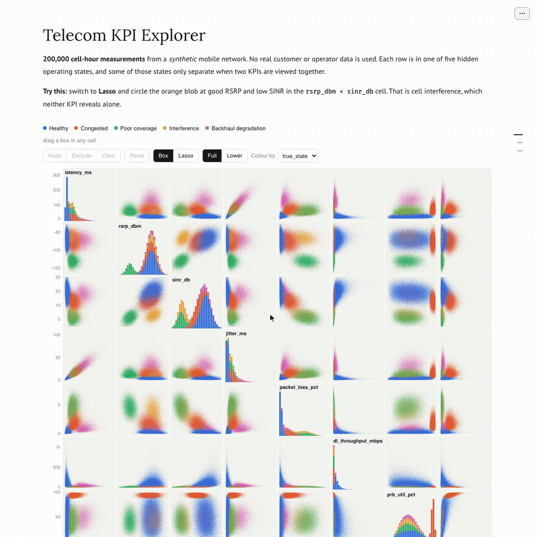
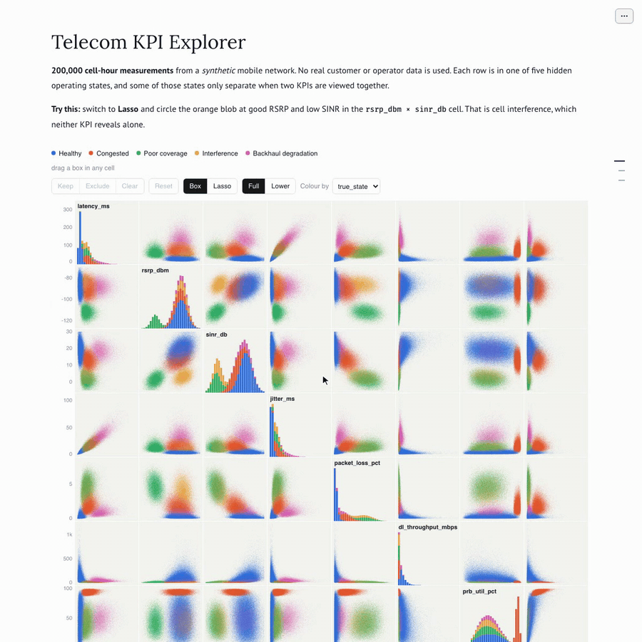
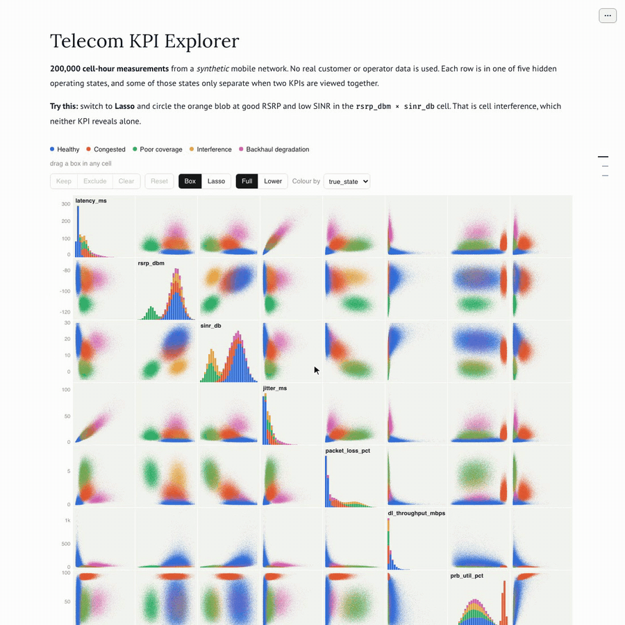
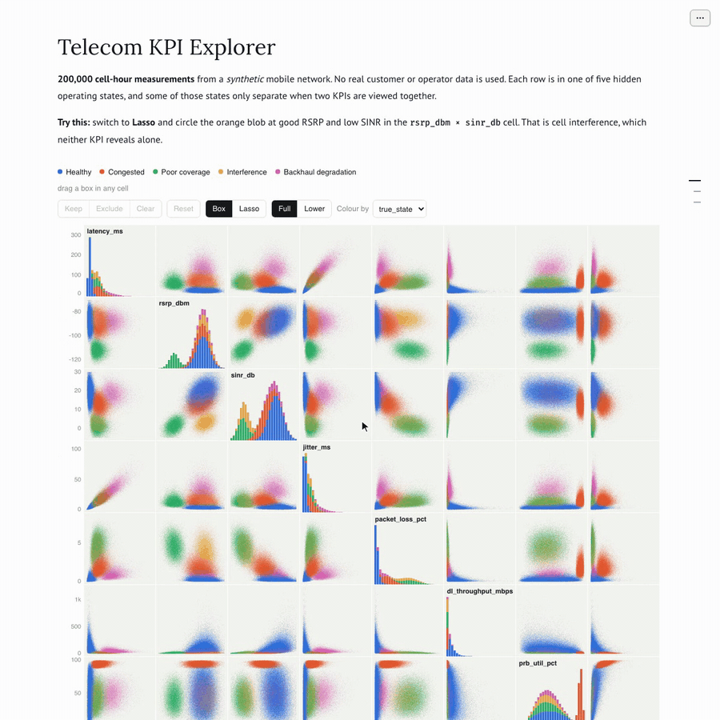

# Telecom KPI Explorer

An interactive, crossfiltering **scatter-plot matrix** for high-dimensional data, built as an
[anywidget](https://anywidget.dev) and run in a [marimo](https://marimo.io) notebook. The demo
explores **200,000 rows of synthetic mobile-network cell KPIs** in the browser, with every brush
synced back to Python.



> **All data is synthetic.** It comes from a seeded generator (`data/generate.py`) and contains no
> real customer or operator data.

## Why a pair plot?

Network faults often hide from single metrics. In this dataset, **Interference** has normal signal
strength (RSRP) and the same low SINR as poor coverage, so neither histogram isolates it. Plot
`rsrp_dbm × sinr_db` and it appears as its own cluster.

K-means misses it too. Fitted with five clusters on the standardised KPIs, it files about 97% of
Interference rows under the same cluster as Poor coverage, while splitting Healthy in two. Switch
**Colour by** to `cluster`, lasso the blob, and the summary table shows the mislabelling.

## Run it

Requires Python 3.12+ and [uv](https://docs.astral.sh/uv/).

```bash
uv sync
uv run python data/generate.py --rows 200000 --seed 7
uv run marimo run notebooks/explorer.py    # app view, code hidden
uv run marimo edit notebooks/explorer.py   # notebook view, press Run
```

The notebook generates the dataset on first run if the file is missing.

## Using the widget

```python
import marimo as mo
from kpi_explorer import PairPlot

pp = mo.ui.anywidget(PairPlot(df, columns=[...], color="true_state", max_points=None))

pp.selection  # live selection geometry, or None
pp.filters  # applied keep and exclude steps
pp.selected_indices()  # NumPy row indices in the selection and filters
pp.filtered_df()  # rows that pass the filters
pp.selected_df()  # rows in the selection and filters
pp.group_counts()  # selected rows per colour group
pp.pipeline_text()  # the filter pipeline as a sentence
```

Selections re-run downstream marimo cells automatically. With no live selection,
`selected_indices()` and `selected_df()` return every row that passes the filters.

| Action | How | Shortcut |
|---|---|---|
| Box select | Drag in a scatter cell | `B` |
| Range select | Drag in a diagonal histogram | |
| Lasso select | Switch to Lasso, drag in a scatter cell | `L` |
| Keep or exclude selection | Toolbar | `K` / `X` |
| Clear selection | Toolbar, or click a cell | `Esc` |
| Remove all filters | Toolbar | `R` |

## Demo

| | |
|---|---|
| **Overview:** 8×8 matrix of 200k points |  |
| **Filter stack:** keep, exclude, axes zoom, reset |  |
| **Python sync:** the summary cell updates reactively |  |
| **Model vs truth:** K-means labels on the Interference blob |  |

Each GIF has an MP4 alongside it in `assets/gifs/`.

## Design decisions

**Binary transfer.** Columns travel as one `Float32Array` buffer and colour groups as `Uint8Array`,
about 7 MB in total. No row data is sent as JSON. All colour-by columns are sent once, so switching
colour needs no further transfer.

**Selection runs in JavaScript.** Brushing has to respond within a frame, so the browser computes a
`Uint8Array` mask. A y-bucketed edge index means each point tests only the few polygon edges near
its scanline instead of every edge.

**Sync geometry, not masks.** On mouse-up the browser sends only the shape, and NumPy recomputes the
rows. Both sides evaluate the same float64 expressions on the same float32 values, so they agree
exactly. The test suite runs the real `widget.js` under Node and compares every row, including
points on vertices and edges, self-crossing polygons, and NaN.

**Canvas layers.** One canvas holds the points, one holds labels, and one holds the brush outline
and crosshair, so drawing a lasso never forces the points to redraw on its own.

### Performance log

Measured in headless Chromium on an 8-core Apple Silicon Mac at 2× pixel density, with 8 features
and 200,000 rows. The target was 50 ms per frame, with WebGL as the fallback. Each row is one change.

| Change | Result |
|---|---|
| Baseline: alpha-blend every point into `ImageData` | Full frame 65 ms, of which scatter 57 ms |
| Use `Int32Array` blending and remove a per-point branch | 63 ms |
| Draw the lower triangle and mirror it into the upper | **41 ms** |
| Cache a grey layer, draw only selected points, thin large selections while dragging | Brush frames 11–17 ms |
| Build the grey layer during browser idle time | Worst brush frame 56 → **20 ms** |
| Build layers lazily and split filter updates across two frames | Colour switch 76 → 44 ms, filter update 54 → 36 ms |

Every measured frame finished under 50 ms, so the WebGL fallback was not needed. In `marimo edit`,
pressing Run paints the full matrix in 0.9–1.1 s. Thinning affects only how many selected points are
drawn during a drag. Counts and histograms always use every row, and the frame is redrawn in full on
mouse-up.

Set `KPI_EXPLORER_DEV=1` to log brush frame times to the browser console.

## Prior art

A search in November 2026 did not find a published anywidget pair plot with this crossfiltering
model, so this one was built from scratch. Related projects:

- [Jupyter Scatter](https://github.com/flekschas/jscatter/): linked, large-scale scatter plots.
- [scatter3d-anywidget](https://pypi.org/project/scatter3d-anywidget/): 3D scatter with lasso.
- [wigglystuff](https://pypi.org/project/wigglystuff/): a collection of creative anywidgets.
- [marimo plotting](https://docs.marimo.io/api/plotting/): reactive selections on single charts.

## Development

```bash
uv run pytest
uv run ruff format . && uv run ruff check .

uv run playwright install chromium
uv run python scripts/record_gifs.py   # re-record every demo GIF and MP4
```

`record_gifs.py` uses `ffmpeg` from your PATH, or the binary bundled with the `imageio-ffmpeg` dev
dependency.
